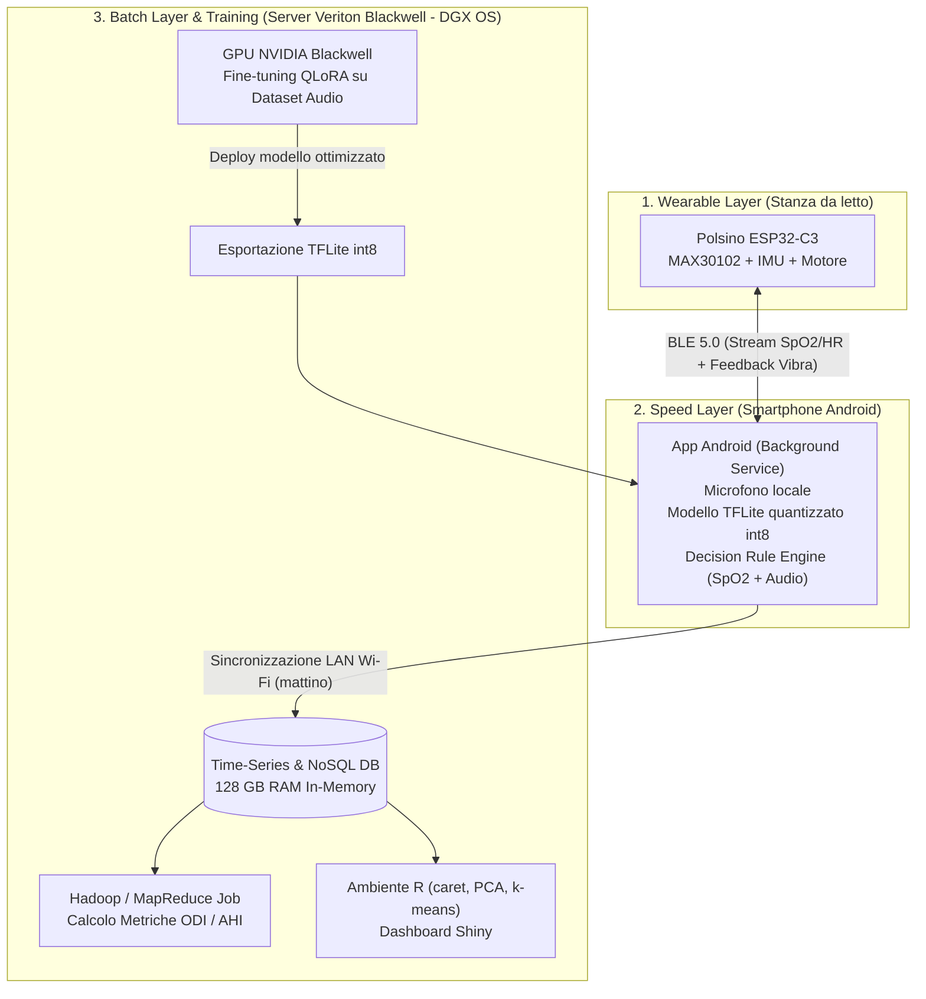
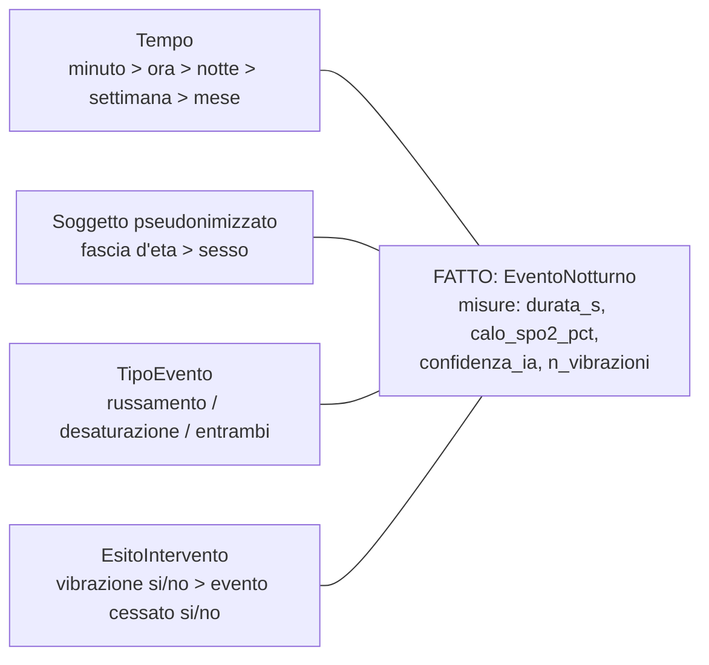

# Analisi del Progetto – Polsino Anti-Russamento e Monitoraggio Apnee

> **Esami di riferimento (UNINETTUNO – Laurea Magistrale, 1° anno):**
> - **Introduzione ai Big Data** (9 CFU)
> - **Sistemi giuridici per i Big Data** (6 CFU)
>
> **Titolo proposto:**
> *"Progettazione di un'architettura ibrida di Biomedical Stream Analytics per il monitoraggio in tempo reale e l'analisi predittiva dei disturbi respiratori del sonno (OSAS)"*

---

## 1. Sintesi del progetto

Un **sistema a ciclo chiuso** che, durante la notte:

1. **Rileva il russamento** tramite un classificatore audio basato su IA che gira in locale.
2. **Rileva sospette apnee** monitorando la saturazione dell'ossigeno (SpO2) e il battito con un sensore ottico sul polso.
3. **Interviene** con una breve vibrazione del polsino (1–2 s) per far cambiare posizione all'utente senza svegliarlo.
4. **Archivia e analizza** i dati della notte per produrre statistiche, grafici e modelli predittivi.

**Principio guida:** un **unico prototipo** e **due relazioni distinte**.
- **Big Data:** architettura dati, streaming, NoSQL, ML, visualizzazione.
- **Sistemi giuridici:** GDPR (dati sanitari), AI Act, MDR, DPIA, sicurezza, assenza di cloud.

> L'hardware è solo lo strumento che genera i dati. Il valore per gli esami sta nella **pipeline dei dati** e nella **compliance**.

---

## 2. Il dispositivo: polsino "all-in-one"

> [!IMPORTANT]
> **Scelta progettuale definitiva: si usa solo il polsino.**
> - Nessun sensore sul dito: niente anello, niente clip, niente cavi verso la mano.
> - Sensore ottico, elettronica, batteria e motorino stanno tutti nel polsino.
>
> Si accetta una precisione minore della SpO2 in cambio di comfort notturno e semplicità costruttiva. I limiti vanno dichiarati nelle relazioni (§2.4).

### 2.1 Componenti

| Componente | Ruolo | Note | Costo indicativo |
|---|---|---|---|
| **Seeed XIAO ESP32-C3** (o ESP32-C3 SuperMini) | Microcontrollore | BLE + Wi-Fi integrati, dimensioni ridotte, deep-sleep | € 3,50 – 9 |
| **MAX30102** | SpO2 e frequenza cardiaca (PPG) | I2C (SDA/SCL + alimentazione) | € 3 – 7 |
| **Motorino a vibrazione ERM piatto (3V)** | Feedback tattile | Silenzioso, da incollare al polsino | € 1 – 3 |
| **Transistor 2N2222 + diodo (1N4007/1N4148) + resistenza di base** | Pilotaggio del motore | I pin dell'ESP32 non reggono la corrente del motore | inclusi sopra |
| **Batteria LiPo 3,7V 300–500 mAh** | Alimentazione | La XIAO ha già il circuito di ricarica; con la SuperMini serve il **TP4056** | € 4 – 9 |
| **Accelerometro/IMU (es. MPU6050 o LIS3DH)** *(consigliato)* | Movimento e posizione del polso | I2C, stesso bus del MAX30102. Serve a scartare le letture PPG disturbate dal movimento e a verificare se dopo la vibrazione l'utente si è girato | ~ € 2 – 4 |
| **Microfono I2S INMP441** *(opzionale)* | Audio sul polsino | Solo per la variante PC senza smartphone | ~ € 2 |
| **Polsino in neoprene/spugna con velcro, piastrina rigida, cavi, guaina** | Struttura e isolamento | Il velcro permette di regolare la pressione | € 3 – 8 |
| **Totale** | | | **~ € 17 – 40** |

### 2.2 Assemblaggio
- **Sensore** nella parte interna del polso, dentro una "finestra" nel tessuto, con i LED a contatto con la pelle.
- **Piastrina rigida** sopra il sensore, per tenerlo premuto. Su di essa vanno ESP32 e batteria.
- **Motorino** incollato alla struttura, così la vibrazione si sente bene.
- **Sviluppo** su breadboard. Il polsino si monta solo per la demo finale (non serve un PCB definitivo).

### 2.3 Sicurezza notturna
- **Isolamento totale** dei circuiti con guaina termorestringente o micro-case, per proteggerli dal sudore.
- **Mai dormire con il polsino in carica.**

### 2.4 ⚠️ Il limite tecnico principale: SpO2 sul polso
Sul polso la pelle è più spessa e i capillari sono meno superficiali. In più i movimenti creano **artefatti** nel segnale PPG, con rischio di **falsi positivi** (cali di SpO2 che in realtà non ci sono).

**Contromisure da descrivere in relazione:**
- polsino aderente, sensore nella parte interna del polso;
- **filtraggio software** (passa-banda, media mobile) e **indice di qualità del segnale**: le letture con troppo movimento si scartano;
- **fusione con l'accelerometro**: se il polso si muove, le letture di SpO2 di quella finestra vengono marcate come inaffidabili e non fanno scattare la vibrazione;
- **più indicatori insieme**: la frequenza cardiaca e la sua variabilità (HRV) sono più affidabili della SpO2 dal polso. Un'apnea si sospetta solo quando calo di SpO2, variazione del battito e assenza di movimento coincidono;
- **validazione**: confrontare per qualche notte i valori del polsino con un pulsossimetro da dito commerciale. Il pulsossimetro serve **solo come riferimento di test** e non fa parte del dispositivo. I risultati vanno nella relazione di Big Data (tema della *Veracity*);
- uso del **calo relativo** rispetto al baseline personale invece di una soglia assoluta (vedi §4.3);
- dichiarare in modo esplicito che il dispositivo è un **prototipo accademico, non diagnostico**. Questo punto serve anche alla relazione giuridica.

---

## 3. Architettura: dove si analizzano i dati?

### 3.1 Ripartizione Hardware dell'Infrastruttura
Il progetto sfrutta un'infrastruttura distribuita a tre nodi fisici complementari:

1. **MacBook Air M1 (8GB RAM):**
   * *Ruolo:* **Workstation di Sviluppo & Client**.
   * *Funzioni:* Scrittura codice C++ (firmware ESP32), sviluppo app Android (Kotlin), stesura relazioni accademiche in Markdown/LaTeX, interfaccia di monitoraggio Git e prototipazione rapida.
2. **Smartphone Android – Fairphone 5 (8GB RAM, SoC Qualcomm QCM6490 Octa-core):**
   * *Ruolo:* **Edge Gateway Notturno (Speed Layer)**.
   * *Specifiche & Vantaggi:* 
     - **Hardware:** Chip Qualcomm QCM6490 con NPU Hexagon integrata (perfetta per accelerare l'inferenza TFLite int8 a bassissimo consumo), Bluetooth 5.2 Low Energy nativo.
     - **Affidabilità OS:** Android pulito privo di killer-process aggressivi tipici di altri brand, fondamentale per garantire l'esecuzione ininterrotta del *Foreground/Background Service* di campionamento durante le 8 ore notturne.
     - **Valore Etico & Giuridico:** Il Fairphone è il punto di riferimento europeo per sostenibilità, diritto alla riparazione (*Right to Repair*), modularità e trasparenza hardware, coerente con l'approccio di etica delle tecnologie e Privacy by Design analizzato nella relazione giuridica.
   * *Funzioni:* Posizionato sul comodino, riceve lo streaming BLE dal polsino, campiona l'audio dal microfono incorporato, esegue l'inferenza AI on-device ed emette il comando di vibrazione in caso di allerta.
3. **Acer Veriton GB10 Blackwell (128GB RAM, 4TB NVMe SSD, DGX OS basato su Ubuntu):**
   * *Ruolo:* **AI Training Server & On-Premises Big Data Engine (Batch Layer)**.
   * *Funzioni:* Addestramento/Fine-tuning avanzato su GPU Blackwell (tecnica QLoRA), cluster Hadoop/HDFS in Docker, database NoSQL (MongoDB/InfluxDB), elaborazione in-memory in R su grandi volumi di dati clinici e hosting della dashboard Shiny.

---

### 3.2 Diagramma dell'Architettura Ibrida a Tre Livelli



---

### 3.3 Confronto delle Alternative di Esecuzione

| Criterio | A – Solo Smartphone | B – Solo PC LAN (Wi-Fi) | C – Architettura Ibrida a 3 Livelli (Adottata) |
|---|---|---|---|
| **Consumo Polsino** | Basso (BLE) | Alto (Wi-Fi continuo) | ✅ **Minimo:** BLE verso telefono; Wi-Fi disattivato sul polsino |
| **Qualità Audio** | Ottima (telefono vicino) | Scarsa (sul polsino) | ✅ **Ottima:** campionamento comodino via Android |
| **Capacità Big Data** | Molto limitata (storage phone) | Media (laptop) | ✅ **Massima:** 128 GB RAM + 4 TB SSD sul server Veriton |
| **Capacità Training AI** | Nulla (solo inferenza) | Limitata (CPU M1) | ✅ **Enterprise:** Accelerazione GPU Blackwell |
| **Privacy / Sovranità** | Isolato sul telefono | Rete locale | ✅ **Air-Gapped On-Premises:** nessun dato esce su Cloud terzi |

---

## 4. Logica di rilevamento e AI

### 4.1 Rilevamento Russamento: Specializzazione tramite Fine-Tuning QLoRA

Per distinguere accuratamente il russamento da suoni notturni confondenti (respiro profondo, tosse, coperte, rumore del condizionatore o traffico urbano), si adotta una pipeline di Machine Learning basata sulle più moderne tecniche di **Parameter-Efficient Fine-Tuning (PEFT)**:

```
[ Dataset Audio: ESC-50, AudioSet + Campioni Notturni ]
                          │
                          ▼
┌─────────────────────────────────────────────────────────────┐
│  Server Veriton Blackwell (DGX OS / Ubuntu - 128 GB RAM)    │
│  1. Caricamento Modello Backbone Audio in 4-bit (NF4)       │
│  2. Iniezione Adattatori Low-Rank (LoRA, r=16, alpha=32)    │
│  3. QLoRA Fine-Tuning supervisionato su spettrogrammi audio │
│  4. Validazione metriche (F1-score, Precision, Recall)      │
│  5. Merge dei pesi LoRA nel backbone                        │
│  6. Quantizzazione Post-Training (PTQ) -> int8 TFLite       │
└─────────────────────────┬───────────────────────────────────┘
                          │
                          ▼ (Deploy file .tflite ~5-15 MB)
┌─────────────────────────────────────────────────────────────┐
│  Smartphone Android (Inferenza locale real-time in RAM)     │
│  Latenza < 50 ms per finestra temporale di 0.975 s          │
└─────────────────────────────────────────────────────────────┘
```

#### Perché QLoRA (*Quantized Low-Rank Adaptation*)?
1. **Efficienza e Precisione:** QLoRA congela il modello di base quantizzato a 4 bit (NormalFloat4) e addestra unicamente piccole matrici di adattamento a basso rango ($A$ e $B$) sui moduli di attenzione. Questo azzera il degrado di precisione (*catastrophic forgetting*) mantenendo l'impronta di memoria contenuta durante l'addestramento.
2. **Modelli candidati:** 
   * **Audio Spectrogram Transformer (AST)** o backbone audio convoluzionali/transformer (**YAMNet / Conformer / Whisper-encoder**).
   * Gli spettrogrammi Mel (frequenze acustiche tempo-varianti) vengono processati estraendo feature ad alta fedeltà.
3. **Pipeline di Compressione per l'Edge:**
   * Una volta completato il fine-tuning sul server Blackwell, i pesi LoRA vengono uniti (*merged*) con il modello originale.
   * Il modello unificato viene convertito ed esportato in formato **TensorFlow Lite (`.tflite`) con quantizzazione completa int8**, ottimizzata per le CPU ARM dei dispositivi Android (consumo batteria trascurabile durante la notte).
4. **Logica di Trigger:**
   * Finestra temporale di campionamento: ~1 secondo.
   * Trigger positivo: classificazione della classe *Snoring* con probabilità $P > 0.85$ per almeno 2 finestre consecutive (filtro anti-falsi positivi).

### 4.2 Apnea (SpO2)
- **Regola del brainstorming:** SpO2 < 90% per 8–10 s.

### 4.3 Miglioramento consigliato
La letteratura clinica (criteri AASM) definisce l'evento di desaturazione come un **calo ≥ 3–4% rispetto al baseline**, non come una soglia assoluta. Conviene quindi usare:
- **baseline mobile** personale (es. mediana degli ultimi minuti);
- evento = calo ≥ 3% che dura ≥ 10 s **e** qualità del segnale accettabile;
- metrica di sintesi della notte: **ODI** (*Oxygen Desaturation Index*, eventi/ora), vicino concettualmente all'**AHI**.

### 4.4 Attivazione
`(Snoring confermato) OR (Desaturazione confermata)` → comando VIBRA (1–2 s) → **periodo di refrattarietà** (es. 60 s) per non vibrare di continuo. Ogni attivazione viene registrata come evento nel DB.

---

## 5. Esame "Introduzione ai Big Data" (9 CFU)

> **Fonti consultate:**
> [Pianificazione didattica](file:///Users/massimopettina/Documents/Universita/uninettuno/primo_anno/introduzione_ai_big_data/big_data_Pianificazione.pdf) (07/08/2024),
> [Guida esame](file:///Users/massimopettina/Documents/Universita/uninettuno/primo_anno/introduzione_ai_big_data/Guida_esame_Introduzione_ai_big_data.pdf),
> [Template relazione](file:///Users/massimopettina/Documents/Universita/uninettuno/primo_anno/introduzione_ai_big_data/Indicazione_relazione.pdf),
> [Dispensa del corso](file:///Users/massimopettina/Documents/Universita/uninettuno/primo_anno/introduzione_ai_big_data/Dispensa.pdf),
> [Regolamento CdS LM-32](file:///Users/massimopettina/Documents/Universita/uninettuno/Regolamento-CdS-Ingegneria-Magistrale-Informatica_new.pdf).

### 5.1 Cosa chiede davvero l'esame

**Persone:**
- Docente: **Prof. Emanuel Weitschek** (presidente di commissione)
- Tutor: **Dr. Daniele Pirrone**
- Membro di commissione: Prof. Claudio Fornaro

**Esame vero e proprio:**
- prova **scritta di 2 ore**, su carta, con **domande aperte**, senza materiali;
- la guida più vecchia prevedeva anche una parte di programmazione in **R e Hadoop/MapReduce**;
- un **orale** è possibile, previo accordo con il docente.

**Requisiti di ammissione:**
- tutte le videolezioni seguite;
- gli esercizi indicati come obbligatori;
- il questionario di valutazione;
- **almeno due esercizi consegnati**, tra cui:
  - una **relazione di almeno 20 pagine** su uno degli esercizi proposti **oppure** sull'approfondimento di un argomento del corso;
  - una **presentazione di massimo 10 slide** (parole chiave e schemi, non solo testo);
  - entrambe caricate sul portale in un unico .zip, **entro la chiusura delle prenotazioni**.

**Peso della relazione sul voto:**
- la relazione **non fa media** nel voto;
- una relazione **plagiata** abbassa il punteggio;
- una relazione **ben fatta, con valori aggiunti come un esperimento**, viene considerata per la **Lode**, ma solo se lo scritto prende 30.

**Formato** (dal template del docente):
- **20–25 pagine** inclusi grafici e tabelle, appendice esclusa (la pianificazione dice "almeno 20": l'obiettivo è quindi 20–25);
- sezioni: *Premessa/Introduzione → Svolgimento → Conclusioni → Sviluppi futuri → Bibliografia/Sitografia → Appendice*;
- **codice solo in appendice**, richiamato nel testo come `file – riga` (es. `odi_mapper.py - 12`);
- ogni figura e tabella con **didascalia numerata** e fonte, se non prodotta da te;
- niente copia-incolla: le definizioni vanno citate con riferimenti `[n]`.

> [!IMPORTANT]
> **Conferma ufficiale del Tutor (Dr. Pirrone):**
> Nello scambio email di ottobre 2026, il tutor Dr. Daniele Pirrone ha confermato formalmente: *«Perfetto siamo allineati, buono studio»* rispetto alla modalità da te esposta:
> 1. Visione di tutte le videolezioni;
> 2. Elaborato di **approfondimento a scelta tra gli argomenti del corso di almeno 20 pagine** (il nostro progetto polsino);
> 3. **Presentazione tramite slide (massimo 10)** di sintesi;
> 4. Compilazione del questionario di valutazione.
>
> Questo significa che la modalità "approfondimento a scelta da 20 pagine con esperimento" è **già pienamente approvata e valida per l'ammissione**. Resta solo da preparare l'elaborato secondo i criteri e caricarlo sul portale prima dell'appello.

### 5.2 Mappatura sul programma reale (videolezioni)

| # | Argomento (Pianificazione) | Lez. | Cosa dice la dispensa | Come entra nel progetto |
|---|---|---|---|---|
| 1 | Introduzione ai Big Data e **Data Governance** | 1–2 | 5V, data life-cycle, principi di governance (*meaning* = glossario, *mapping* = vista unica dei dati), **Dimensional Fact Model (DFM)** | Glossario dei dati (SpO2, ODI, evento, notte). **DFM** con fatto `EventoNotturno` (§5.3) |
| 2 | **Hadoop e MapReduce** | 3–4 | HDFS, split da 128 MB, map → shuffle → reduce, YARN | **Job MapReduce** che calcola ODI e minuti di russamento per *utente × notte* su un dataset (anche simulato) di migliaia di notti (§5.4) |
| 3 | **NoSQL** | 5 | Database **key-value**: storage node, replication node, shard, *replication factor* (più letture veloci, scritture più lente) | Chiavi `utente:notte:timestamp` → valore JSON. Buffer in tempo reale in un key-value in-memory (es. Redis), storico su MongoDB/InfluxDB. Discussione del replication factor: dashboard (letture) vs stream (scritture) |
| 4 | **Machine Learning** | 6–7 | Supervisionato e non supervisionato, **PCA**, **k-means**, **clustering gerarchico**, split 80/20 | Supervisionato: classificatore audio del russamento. Non supervisionato: **PCA** sulle feature notturne e **k-means** per scoprire "tipi di notte" (tranquilla, russamento posizionale, desaturazioni frequenti) |
| 5 | **Analisi con R** | 8–13 | Processo **CRISP-DM**; pacchetto **caret** (`train` con `gbm` e `svmRadial`, `resamples`, `varImp`, `confusionMatrix`); **classi sbilanciate** (`downSample`, `upSample`, SMOTE) e **curva ROC** | Le apnee sono **eventi rari**, quindi le classi sono sbilanciate: è lo stesso caso della dispensa. Si confrontano GBM e SVM con `resamples`, si usa `varImp` per spiegare quali feature contano, ROC dopo il bilanciamento |
| 6 | **Analisi biomedicali** | 18 | Processo **KDD** (selection → preprocessing → transformation → data mining → interpretation); caso **EEG + FFT + alberi di classificazione**; database pubblici (TCGA, NCBI) | **Analogia diretta:** audio/PPG → **FFT/MFCC** → classificatore, come nel caso EEG. Pipeline KDD esplicita. Validazione su dataset pubblici di polisonnografia (PhysioNet) |
| 7 | **Data visualization** | 19 | Differenza tra dashboard e infografica, componenti, principi di design | **Dashboard Shiny** per l'analisi della notte e **infografica** per le 10 slide |
| — | Appendici: statistica descrittiva, modelli, test d'ipotesi | — | Indici, correlazione, regressione, test d'ipotesi, valutatori | Statistiche di SpO2, correlazione russamento/desaturazione, **test d'ipotesi dell'esperimento** (§5.5) |
| — | Social e Marketing analytics | 14–17 | — | Non pertinenti |

> [!NOTE]
> **Elementi fuori programma**, da presentare come approfondimento e non come argomento del corso:
> - l'architettura **Lambda** (speed layer e batch layer);
> - **MQTT**;
> - lo stream processing.
>
> Il brainstorming le attribuiva a una "Lezione 1", ma nella pianificazione non compaiono.

### 5.3 Data Governance: modello DFM



### 5.4 MapReduce: calcolo dell'ODI per notte

- **Input:** righe `utente, notte, timestamp, spo2, flag_desaturazione` su HDFS.
- **Map:** per ogni riga con `flag_desaturazione = 1` emette `(utente|notte, 1)`. Per ogni riga emette anche `(utente|notte#durata, 1 s)`.
- **Shuffle:** raggruppa per chiave `utente|notte`.
- **Reduce:** `ODI = n_eventi / ore_registrate`. Lo stesso schema vale per i minuti di russamento.
- **Esecuzione:** **Hadoop Streaming** con mapper e reducer in Python o R, su un'installazione single-node in Docker.

È un esercizio identico a quelli che possono capitare allo scritto.

### 5.5 L'esperimento e la simulazione su larga scala (Server Veriton Blackwell)

Grazie alla disponibilità della workstation **Acer Veriton GB10 Blackwell (128 GB RAM, 4 TB NVMe SSD, DGX OS)**, il progetto può spingersi ben oltre il singolo auto-esperimento:

1. **Auto-esperimento sul campo:**
   * N notti con vibrazione attiva e N notti con vibrazione disattivata (solo logging), alternate.
   * Ipotesi: la vibrazione riduce significativamente la durata del russamento e l'indice ODI.
   * Analisi statistica inferenziale in R: test t di Student / Wilcoxon rank-sum test, effect size (Cohen's d) e grafici a violino/box-plot.
2. **Benchmark su Dataset Clinici di Popolazione (PhysioNet):**
   * Il server Veriton permette di scaricare e caricare in-memory dataset massivi di polisonnografia clinica reale (es. **PhysioNet Sleep-EDF**, **SHHS - Sleep Heart Health Study**, decine di Gigabyte).
   * Esecuzione di benchmark comparativi: confronto tra l'algoritmo di stima ODI/apnea sviluppato nel progetto e le annotazioni cliniche polisonnografiche ufficiali eseguite dai medici specialisti.
3. **Elaborazione Parallela In-Memory in R & MapReduce:**
   * Sfruttamento dei **128 GB di RAM** per elaborare time-series di migliaia di notti senza swapping su disco (argomento centrale della Lezione 5 sugli In-Memory DB).
   * Esecuzione di job MapReduce scalabili in container Docker su DGX OS per dimostrare la fattibilità dell'architettura su una popolazione estesa di pazienti.

### 5.6 Le 10 slide (sintesi della relazione)

1. Titolo
2. Problema (OSAS)
3. Architettura
4. DFM e governance
5. Pipeline KDD e classificatore audio
6. Pipeline NoSQL e MapReduce
7. R/caret (ROC, varImp)
8. PCA e k-means
9. Esperimento e risultati
10. Conclusioni e sviluppi futuri

Usare schemi e parole chiave, non blocchi di testo.

---

## 6. Esame "Sistemi giuridici per i Big Data" (6 CFU)

> **Fonti ufficiali consultate:**
> [Guida all'esame 2022](file:///Users/massimopettina/Documents/Universita/uninettuno/primo_anno/sistemi_giuridici_per_big_data/materiale/UTIU_Guida_esameSistemi_giuridici_per_i_big_data_2022.pdf),
> [Pianificazione didattica 2026/2027](file:///Users/massimopettina/Documents/Universita/uninettuno/primo_anno/sistemi_giuridici_per_big_data/materiale/Pianificazione%20didattica%20-%20Sistemi%20giuridici%20per%20i%20big%20data%20%20-%20doppia%20lingua%20-.pdf).

### 6.1 Come funziona realmente l'esame

**Docente e Commissione d'esame:**
- Docente-Tutor e Presidente di Commissione: **Prof.ssa Favorita Barra**
- Membri di Commissione: **Prof. Enrico Mezzanotte**, **Prof.ssa Laila Bauleo**
- Docenti delle 19 videolezioni: **Prof. Giorgio Pino** (Univ. Palermo) e **Prof.ssa Flick**

**Modalità della prova d'esame:**
- Prova **scritta di almeno 2 ore**, su carta, con **domande a risposta aperta** sui temi del corso.
- > [!TIP]
  > **Testi di legge consultabili durante lo scritto:** la guida stabilisce che *«sono consultabili i testi di legge non commentati»* (vietati libri e appunti). Questo è un vantaggio enorme: prepararsi con stampe dei testi normativi ufficiali (GDPR Reg. UE 2016/679, AI Act Reg. UE 2024/1689, Codice Privacy D.Lgs. 196/2003 e articoli del Codice Penale).
- È prevista la possibilità di svolgere l'esame orale in presenza previo accordo con la docente.

**Requisiti per l'ammissione all'esame:**
1. Visione completa di tutte le **19 videolezioni** per almeno una volta (raccomandata due volte);
2. **Consegna di almeno 2 degli esercizi** collegati alle videolezioni pubblicati sul portale (in coda a ogni videolezione c'è una domanda aperta riepilogativa);
3. Tracciamento quantitativo (forum, chat, mediateca);
4. Partecipazione alle attività col tutor (classi interattive registrate o sincrone il venerdì alle 19:15);
5. Questionario di valutazione dell'insegnamento prima dell'appello.

**Ruolo del nostro progetto per questo esame:**
- A differenza di Big Data, qui non è obbligatoria una tesina di 20 pagine per l'ammissione, ma la **consegna di almeno due esercizi**.
- Il nostro progetto e la relativa relazione giuridica possono essere utilizzati in due modi strategici:
  1. **Come svolgimento d'eccellenza di uno o due degli esercizi obbligatori** da caricare sulla piattaforma (in particolare per le videolezioni dell'Area 2 su diritti/privacy o dell'Area 4 su sicurezza e trattamento dati);
  2. Come **project work / approfondimento tematico concordato con la Prof.ssa Favorita Barra** per valorizzare il percorso e puntare al massimo dei voti allo scritto.

---

### 6.2 Testi di riferimento ufficiali (da citare obbligatoriamente)

Per dare massimo rigore accademico alla relazione, la bibliografia deve attingere direttamente ai testi d'esame indicati dalla Prof.ssa Barra:
1. **Giovanni Sartor**, *L'informatica giuridica e le tecnologie dell'informazione*, Torino, Giappichelli, 2022 (Libro di testo principale);
2. **Stefano Rodotà**, *Il diritto di avere diritti*, Roma-Bari, Laterza, 2015; e *Tecnologie e diritti*, Bologna, Il Mulino, 1995;
3. **Giovanni Pascuzzi**, *Il diritto dell'era digitale*, Bologna, Il Mulino, 2020;
4. **G. Ziccardi**, *Informatica giuridica*, Milano, Giuffrè, 2020 (Tomo I);
5. **E. Tosi**, *Contratti informatici, telematici e virtuali*, Milano, Giuffrè;
6. **G. Fasano**, *Computer forensic e sicurezza informatica 1*, 2017;
7. **Sabino Cassese**, *La globalizzazione del diritto*, Treccani, 2009 (presente nei materiali didattici della Lezione 1).

---

### 6.3 Mappatura del progetto sulle 4 Aree Concettuali Ufficiali

Il programma del corso si articola in **4 aree concettuali** (19 videolezioni totali), a cui corrispondono anche le classi interattive:

| Area Concettuale | Videolezioni | Testi e Argomenti | Come integrare il Progetto Polsino |
|---|---|---|---|
| **1) Informatica e diritto nell’era digitale** | Lez. 1–5 | Ziccardi, Pascuzzi, Cassese.<br/>Società dell'informazione, dematerializzazione, ordinamenti multilivello, governance di Internet. | Inquadrare il dato biometrico/sanitario come "materia prima" della società dell'informazione. La regolazione multilivello: norme UE (GDPR/AI Act) e standard tecnici globali (Bluetooth SIG, ISO 27001). |
| **2) Internet e diritti** | Lez. 6–11 | Rodotà, Pascuzzi, Prof.ssa Flick.<br/>Diritti della persona in rete, banche dati (Rodotà), identificazione, motori di ricerca e diritto all'oblio (Google Spain). | **Diritto all'oblio (art. 17 GDPR):** policy di cancellazione automatica dei log notturni. Identificabilità via MAC address BLE. Risoluzione della tensione tra monitoraggio della salute e riservatezza del domicilio. |
| **3) Operare in rete** | Lez. 12–16 | Sartor (2022), Tosi.<br/>Diritto d'autore su software e banche dati, contratti telematici, commercio elettronico, responsabilità degli intermediari. | **Proprietà intellettuale e licenze:** regime di tutela del software (L. 633/1941, art. 64-bis); licenze d'uso del modello pre-addestrato (YAMNet/Apache 2.0) e dei dataset audio (es. ESC-50 CC BY-NC). Responsabilità da prodotto difettoso software (Dir. UE 2024/2853). |
| **4) Trattamento dati, sicurezza e responsabilità** | Lez. 17–19 | Rodotà, Fasano.<br/>GDPR, sicurezza dei dati, computer forensics, reati informatici. | **Cuore della relazione:** DPIA completa (art. 35 GDPR), art. 9 (dati sulla salute), sicurezza BLE/TLS (art. 32). Informatica forense: integrità dei log sanitari come prova informatica. Reati informatici (art. 615-ter, 615-bis c.p.). |

---

### 6.4 Analisi Giuridica Dettagliata per la Relazione

#### A. GDPR (Reg. UE 2016/679)
- **Qualificazione del dato:** SpO2, battito e tracciamento audio notturno sono **dati relativi alla salute** e **dati biometrici** $\rightarrow$ Categorie particolari ex **art. 9 GDPR**. Base giuridica: **consenso esplicito (art. 9.2.a)**.
- **Ambito di applicazione:** chiarire la distinzione tra la fase di prototipo personale (**esenzione per uso domestico, art. 2.2.c**) e lo scenario di rilascio ad utenti/commercializzazione (piena applicazione del GDPR).
- **Rischio audio in camera da letto:** potenziale captazione della voce del partner non consenziente. Soluzione di *Privacy by Design*: elaborazione **esclusivamente volatile in RAM** con TensorFlow Lite; nessun file audio salvato o trasmesso, persistenza limitata al metadato dell'evento (*"snoring detected at timestamp T"*).
- **Principi (art. 5):** minimizzazione, limitazione delle finalità, limitazione della conservazione, integrità e riservatezza.
- **Sicurezza del trattamento (art. 32):** cifratura a riposo (DB locale/smartphone) e in transito (BLE con Secure Connections / bonding crittografico, e MQTTS con TLS se in LAN).
- **Valutazione d'Impatto (DPIA, art. 35):** redazione di una tabella di DPIA con analisi di necessità, proporzionalità, rischi per i diritti dell'interessato e misure mitigative.

#### B. Inquadramento tra Medical Device (MDR) e AI Act
- **Regolamento Dispositivi Medici (MDR, Reg. UE 2017/745):** 
  - Se un software persegue finalità di **diagnosi o monitoraggio** di una patologia (OSAS), rientra nella definizione di software medico (MDSW) e per la **Regola 11** è classificato in **classe IIa** (richiede organismo notificato).
  - Nel nostro caso, per la fase attuale si adotta la qualificazione di **dispositivo wellness/lifestyle** per il miglioramento della qualità del sonno con apposito disclaimer medico (*"Non è un dispositivo medico, consultare un medico in caso di sintomi"*).
- **AI Act (Reg. UE 2024/1689):**
  - Discussione della classificazione del modello di IA: se qualificato come accessorio a un dispositivo medico MDR rientrerebbe nei sistemi ad **alto rischio** (art. 6.1 + All. I) con obblighi stringenti di governance dei dati, documentazione tecnica, logging e sorveglianza umana; come sistema standalone wellness è soggetto a obblighi di trasparenza e corretta informazione all'utente.

#### C. Diritto Penale e Computer Forensics (G. Fasano)
- **Profili penalistici:**
  - *Art. 615-ter c.p.* (Accesso abusivo a sistema informatico): protezione del polsino e del DB locale da intrusioni non autorizzate.
  - *Art. 615-bis c.p.* (Interferenze illecite nella vita privata): rischio legato a registrazioni sonore non autorizzate nel domicilio; scongiurato dall'assenza di registrazione fisica di flussi audio.
  - *Art. 617-quater c.p.* (Intercettazione illecita di comunicazioni informatiche): motivazione dell'uso di cifratura sul canale BLE/Wi-Fi.
- **Computer Forensics:** applicazione dei principi di integrità (hashing SHA-256) nella memorizzazione dei log di evento del polsino, per garantire la catena di custodia e l'utilizzabilità come prova informatica in caso di contenziosi.

#### D. Sovranità Digitale e "Private On-Premises Health Cloud"
- **Isolamento Air-Gapped su Server Veriton (DGX OS):**
  - La presenza del server domestico dedicato (Acer Veriton 128 GB) permette di implementare un'architettura **Private Cloud On-Premises**.
  - **Eliminazione del trasferimento transfrontaliero:** I dati sanitari non transitano né risiedono su server di cloud provider commerciali extracomunitari (AWS, Azure, Google Cloud). Viene azzerata alla radice la complessa problematica del trasferimento di dati verso Paesi terzi (Capo V GDPR, dottrina *Schrems II* ed *EU-US Data Privacy Framework*).
  - **Data Breach Containment (art. 33-34 GDPR):** L'assenza di endpoint esposti su Internet pubblico riduce drasticamente la superficie di attacco, garantendo il pieno controllo fisico e logico delle chiavi crittografiche da parte dell'utente.

---

## 7. Struttura delle due relazioni

### Relazione 1 – Introduzione ai Big Data (template del docente, 20–25 pagine + appendice)

**1. Premessa / Introduzione**
- OSAS e motivazione
- argomento di approfondimento: Biomedical Analytics
- descrizione del prototipo

**2. Svolgimento**
1. Data Governance: glossario e **DFM**
2. Architettura e data ingestion (BLE / MQTT, buffering)
3. Pipeline **KDD**: segnali PPG e audio, FFT/MFCC, classificatore
4. Storage **NoSQL key-value** (shard, replication factor)
5. Elaborazione batch con **Hadoop/MapReduce** (ODI per notte)
6. **R/caret**: CRISP-DM, GBM vs SVM, classi sbilanciate, ROC, varImp
7. **PCA e k-means** sui profili notturni
8. **Esperimento** e test d'ipotesi
9. **Data visualization** (dashboard Shiny)

**3. Conclusioni**

**4. Possibili sviluppi futuri**
- scalabilità su cluster (Spark, Kafka)
- validazione clinica

**5. Bibliografia / Sitografia**, con citazioni `[n]`

**6. Appendice**
- codice ESP32
- codice Python
- mapper e reducer
- script R

**Allegato:** presentazione di massimo 10 slide (§5.6).

### Relazione 2 – Sistemi giuridici per i Big Data (formato da verificare con la guida d'esame)
1. Introduzione: società dell'informazione e dato sanitario come materia prima
2. Descrizione del trattamento e dei flussi di dati
3. Quadro multilivello e globalizzazione (Cassese): UE, standard, trasferimenti
4. Protezione dei dati: art. 9, basi giuridiche, Privacy by Design, art. 17 (oblio)
5. **DPIA** completa
6. AI Act e MDR: wellness vs medicale
7. Diritto privato dell'informatica: software, licenze, dataset, responsabilità da prodotto
8. Diritto penale e processuale dell'informatica: rischi e log come prova
9. Conclusioni e scenario di commercializzazione

> [!CAUTION]
> **Due relazioni sullo stesso prototipo vanno bene, ma devono essere testi distinti.** Il docente di Big Data penalizza il plagio, e riusare paragrafi identici tra i due esami potrebbe essere letto come auto-plagio. Conviene dichiarare in entrambe che il prototipo è comune ai due insegnamenti.

---

## 8. Incongruenze del brainstorming da risolvere

| Punto | Problema | Decisione proposta |
|---|---|---|
| Posizione del sensore | A volte "anello sul dito", a volte "polsino all-in-one" | ✅ **Deciso: solo polsino**, nessun sensore sul dito (§2) |
| Connettività | BLE (smartphone) vs Wi-Fi/MQTT (PC) | **Ibrida**: BLE di notte, sincronizzazione LAN al mattino (§3.4) |
| Ricarica | TP4056 vs caricatore integrato della XIAO | Con la **XIAO ESP32-C3** il TP4056 non serve |
| Piattaforma app | Citato anche iOS | **Solo Android** |
| Soglia apnea | SpO2 < 90% assoluta | **Calo relativo ≥ 3%** dal baseline (§4.3) |
| Privacy Shield | Citato come tema attuale | Aggiornare con **Data Privacy Framework 2023** |
| Numeri di lezione | "R Lez. 8–13", "Sistemi ibridi Lez. 1", docenti "Venturini/Barboni" | Pianificazione ufficiale: R = Lez. 9–12 (la dispensa ha capitoli 8–13); Lambda/stream **non sono in programma**; i docenti citati non risultano nei documenti ufficiali |
| Relazione Big Data | Il brainstorming non diceva che la relazione non fa media | La relazione è **requisito di ammissione** e conta **solo per la Lode** (§5.1) |
| Hadoop/MapReduce | Assente nel brainstorming | È nel programma (Lez. 3–4) e forse nello scritto: aggiunto (§5.4) |

---

## 9. Roadmap operativa

**Azioni preliminari:**
1. ✅ **Accordo con il tutor Dr. Pirrone (Big Data):** **CONFERMATO VIA EMAIL** (8 ottobre 2026). La modalità *approfondimento a scelta da almeno 20 pagine + presentazione di max 10 slide* è pienamente valida e approvata per l'ammissione.
2. **Allineamento con la docente-tutor Prof.ssa Favorita Barra (Sistemi Giuridici):** verificare se la tesina/DPIA può valere per l'esonero/completamento dei due esercizi obbligatori di ammissione sulla piattaforma.

**Sviluppo:**
3. **Hardware base:** ESP32 + MAX30102 su breadboard, lettura SpO2/HR.
4. **Attuatore:** motorino con transistor.
5. **Comunicazione:** BLE (A) e/o MQTT verso Mosquitto (B).
6. **IA audio:** dataset (verificando le licenze), fine-tuning YAMNet, metriche, export TFLite.
7. **Logica di decisione e logging degli eventi.**
8. **Storage:** key-value/NoSQL + DFM.
9. **MapReduce:** job ODI su Hadoop single-node.
10. **R:** EDA, caret (GBM/SVM, sbilanciamento, ROC), PCA e k-means, dashboard Shiny.
11. **Esperimento:** notti con e senza vibrazione, test d'ipotesi.

**Consegna:**
12. **Relazioni:** due testi distinti + 10 slide, caricati entro la chiusura delle prenotazioni.
